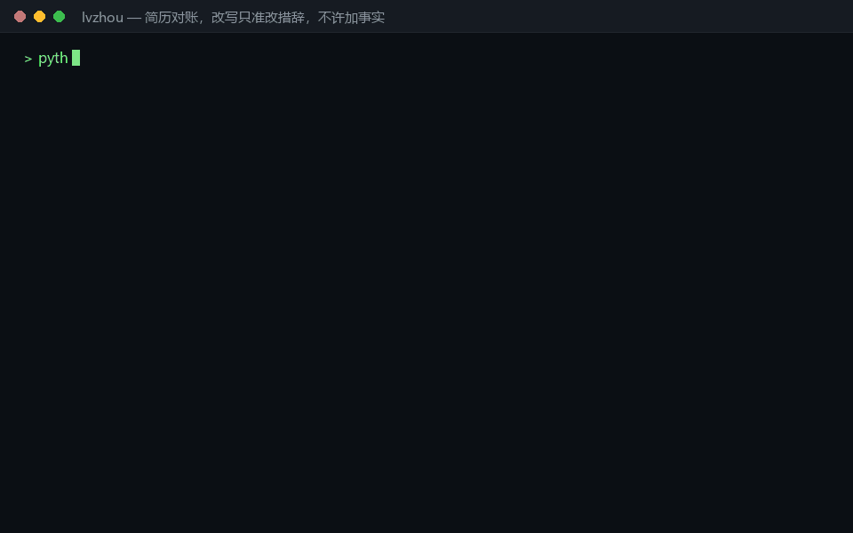
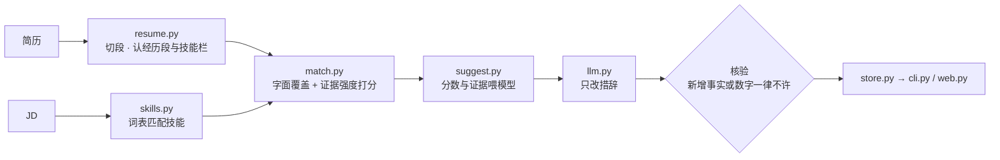

# Lvzhou · Resume vs JD Check

[](https://github.com/wushiyi105-jpg/lvzhou/actions) []() [](./LICENSE) [](https://codecov.io/gh/wushiyi105-jpg/lvzhou)

Before applying, put the resume and the JD side by side: **what it asks for, do you have it; and the things you have — are they in your experience, or only in the skills box.**

I split it in two: what can be computed is computed locally, only what cannot be goes to the model.

Computable is "literal" — the JD mentions SQL, does the resume contain the two characters SQL, and in which section.
Not computable is "meaning" — your research project actually did data analysis, but you never wrote it that way; that takes a model reading for meaning.

The line is drawn very hard, because I have seen too much: an AI helps someone edit a resume and, along the way, writes them an internship.



## Why "which section" matters

Putting "Python, SQL, Excel" in the skills box is something anyone can do. HR knows anyone can do it.

What actually convinces is when it appears inside experience: "used SQL to pull data, wrote 40 queries" — that sentence reads more substantial than a line in the skills box.

So the local check sorts every skill into three tiers:

| Tier | Meaning |
| --- | --- |
| Have | Appears in work experience or project experience |
| Weak | Appears only in skills, education, awards |
| Missing | Nowhere in the resume |

What is in "求职意向" (career objective) **does not count as evidence** — it says what you want to do, not what you have done. I handled that specifically, because it is the most misleading line in a resume.

## One real run

The samples are a new-graduate resume (`samples/简历-罗晓.txt`) and an AI product manager JD (`samples/JD-AI产品经理.txt`). Both fictional, both written to look real.

```
=== 罗晓 → AI产品经理（应届） ===
匹配度 48.9/100 · 2/9 个要求技能简历里完全没有，4 个只在技能栏
  弱 sql     只在技能栏写了，经历里没体现
      «Python、SQL、Excel（数据透视表、VLOOKUP）、Axure、Figma»
  有 excel   有，而且在经历里用过
      «- 用 Excel 做用户反馈分类，整理出 340 条有效反馈»
  缺 数据分析    简历里没有
  弱 用户研究    只在技能栏写了，经历里没体现
  有 需求分析    有，而且在经历里用过
      «- 负责校园社交 App 的需求梳理，写了 12 份需求文档»
  弱 原型      只在技能栏写了，经历里没体现
  缺 大模型     简历里没有
  弱 英语     只在技能栏写了，经历里没体现
      «英语 CET-4»
  ! JD 要 CET-6，简历里是 CET-4
```

Nine required skills and only two have experience behind them. 48.9 is not a guess: 70% hard-skill coverage, 30% experience evidence.

Every "Have" carries the resume sentence behind it — you can judge immediately whether it is real or whether the tool misread it.

Education, years and English are compared separately because they are hard gates: the JD says CET-6, the resume says CET-4 — that is not "a bit weaker", that is failing the first screen.

## Then let the model rewrite

`advice` hands the resume, the JD and the local check result to the model and asks it to fix the wording:

```
1. 梳理校园社交 App 需求，撰写 12 份需求文档
   原句：负责校园社交 App 的需求梳理，写了 12 份需求文档
   为什么：去掉「负责」，将动词前置，表述更直接有力
2. 使用 Excel 分类用户反馈，提取 340 条有效反馈
3. 参与 3 次版本评审，推进 8 个功能上线
4. 使用 Python 清洗 2017-2025 年政策文本，完成词频统计
5. 输出 28 页调研报告，获评优秀
6. 掌握用户研究方法，能进行深访和可用性测试
```

Six items, every one traceable to an original sentence. **Numbers invented in the rewrites: 0.**

## Verification: no new facts

After the model answers, every "after" sentence passes two gates:

**One: numbers.** Pull every number with a unit out of the original (`12 份`, `340 条`, `28 页`, `2017-2025 年`); if the rewrite contains one the original does not ("服务 300 万用户"), flag it.

Only numbers with units are caught: a date like `2023.07` is not, nor a bare `40` — otherwise a whole resume would be false alarms and the mechanism would be worthless.

**Two: skills.** A skill word appearing in a rewrite is handled two ways:

- Not in the resume, not in the JD → "invented a skill", do not use this one
- Not in the resume, but the JD asks for it → "this is the X the JD wants; keep it only if you really did it"

The second cannot be condemned outright, because it may have done something good: you did run user interviews, you just never wrote them into the resume, and the model named that "user research". That is a judgement for you, not for the program to veto.

Both are hard unit tests: `test_new_number_blocked` asserts an invented number must be caught, `test_jd_skill_goes_to_confirm` asserts a "JD wants, resume lacks" skill goes to confirmation rather than condemnation.

## The limits of a word list, which I know

Skill matching relies on a hand-written list (20-odd canonical names, each with Chinese and English aliases). It knows `Python` / `Python3` / `Py3` are the same, knows 「数据清洗」and「数据分析」belong together, and handles short-word boundaries — `PM` cannot match inside `PMP`.

But it cannot see anything outside the list. The resume says `Hadoop`, the JD wants `Hadoop`, and it sees neither. That is the ceiling of literal matching.

So it makes no final judgement: `match` reports only the literal check, and `advice` is what lets the model read meaning. The model can tell that "走访 2 家社区卫生服务中心，访谈 6 位经办人员" is actually user research; locally that is invisible.

## Data flow

How one piece of data moves between the modules:



## Quick start

```bash
git clone https://github.com/wushiyi105-jpg/lvzhou.git && cd lvzhou
cp .env.example .env      # fill in LLM_API_KEY

python -m lvzhou resume samples/简历-罗晓.txt --name 罗晓
python -m lvzhou jd     samples/JD-AI产品经理.txt
python -m lvzhou match  1 1        # compute only, no model
python -m lvzhou advice 1 1        # compute, then ask the model
```

Start the Web UI:

```bash
python -m lvzhou serve     # http://127.0.0.1:8774
```

Run in Docker (the container uses the default port 8774):

```bash
docker build -t lvzhou .
docker run -p 8774:8774 lvzhou
```

## 🤔 Why not just ask a general LLM

A general model reads your resume and a JD and says "you are a good fit". Lvzhou adds the three things it cannot:

1. **Literal matching is computed locally** — when a JD says SQL, whether the word appears in the resume and in which section is checked line by line, producing a coverage score and the missing keywords. A model's "high fit" has to pass this layer first.
2. **No new facts** — advice changes wording, not history: it will not invent an internship or a project, and every suggestion points back to an original sentence in the resume.
3. **The resume stays local** — phone number, address and work history sit in local SQLite and are not uploaded; a model call sends only the current resume and JD.
4. **Structured output** — coverage, missing items, section locations and rewording advice are fixed fields; a chat reply is encouragement you cannot edit a resume with.

## 🎯 Use cases

- **A pre-submission check**: put the JD and resume together, see which keywords live only in the skills list and not in experience, then decide whether a real project line is missing.
- **Career switching**: from data analysis to product roles, see which JD requirements you can evidence and which you genuinely lack, without relying on a feeling.
- **Helping a friend**: a JD and a resume in, ten minutes later a list of gaps and realistic fixes, rather than "good luck".

## 🗺 Roadmap

- **Multiple resume versions**: one history, several role-specific versions that can be compared.
- **Batch JD comparison**: paste three JDs and see shared versus differing requirements to prioritise.
- **Synonym expansion**: match "data analysis" in a JD with "data cleaning" in a resume to reduce false misses.
- **Advice export**: write suggestions to Markdown and edit alongside, without switching windows.
- **Interview hand-off**: pass the match result into likely interview questions, sharing one resume with the interview repo.

## ❓ FAQ

**Where do I get an API key?**
`match` is local and needs no key; only `advice` calls a model. It defaults to Zhipu (`glm-4.6`), and DeepSeek works too — see `.env.example`.

**Where is data stored, and is it uploaded?**
Resumes and JDs live in local SQLite; a model call sends the current resume and matching JD, not your whole application history.

**Does it work without a key?**
Yes. `match` is a local comparison and still reports coverage and missing keywords; the model's rewording advice is what you miss.

**How do I switch models?**
Change `LLM_BASE_URL`, `LLM_MODEL` and `LLM_API_KEY`; local matching is unaffected.

**Will it invent experience for me?**
No. It changes wording, not facts, and any suggestion referencing experience absent from the resume is flagged rather than adopted.

## Commands

| Command | What it does |
| --- | --- |
| `resume <文件> [--name]` | Store a resume, reporting which sections were found and how many skills have evidence |
| `jd <文件> [--title]` | Store a JD, listing the extracted requirements |
| `list` | Two tables: resumes and JDs |
| `match <简历id> <jd id> [--json] [--out]` | Local check, exportable as markdown |
| `advice <简历id> <jd id> [--json]` | Check + model rewrite, result stored |
| `show <简历id> <jd id>` | The last check |
| `rm resume\|jd <id>` / `stats` / `serve` | Delete / stats / start the Web UI |

## The Web UI

Paste a resume and a JD on the left, one each; on the right pick both and run the check. The skill list is coloured by tier — `有` green, `弱` yellow, `缺` red — with the resume sentence under each.

The "问改写" button lights up only after the check runs — look at the local result first, then decide whether to spend those dozen seconds.

## Design trade-offs

- **Zero third-party dependencies**, Python 3.10+, standard library.
- **Only the latest check per resume+JD pair is kept.** Rerunning before applying is normal; a pile of historical versions just leaves you unsure which to trust.
- **Deleting a resume deletes its checks**, no orphan data.
- **Scores rank, they do not conclude.** There is no real difference between 48.9 and 52; only "which few to shore up" is useful.
- **A model failure does not affect the check.** If the endpoint dies, `match` still gives you the local result and `advice` says plainly "the model gave no rewrite: unreachable".

## Tests

```bash
python -m unittest discover -s tests
```

105 cases, all offline. The model is a double; the Web layer starts a real server on `port=0`.

Covered: five heading spellings in section detection, bracketed `【项目经历】`, career objective not counting as evidence, the `PM` / `PMP` boundary, six units in number extraction, `1 年以内` not being a gate, CET level conversion, three evidence tiers, four verdicts, invented-number blocking, JD-only skills going to confirmation, SQLite upsert and cascade delete.

## Configuration

`.env` (already in `.gitignore`):

```
LLM_API_KEY=...
LLM_BASE_URL=https://open.bigmodel.cn/api/paas/v4
LLM_MODEL=glm-4.6
```

Works with any OpenAI-style `/chat/completions`. `--api-key --base-url --model` override temporarily.

---

Dazhao · 17382987315
