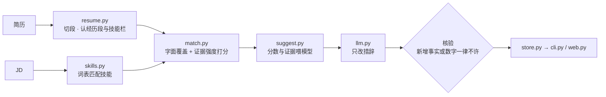

# 履舟 lvzhou

[](https://github.com/wushiyi105-jpg/lvzhou/actions) []() [](./LICENSE) [](https://codecov.io/gh/wushiyi105-jpg/lvzhou)

投岗位之前，把简历和 JD 放一起看一遍：**它要的，你有没有；有的那些，是写在经历里，还是只写在技能栏里。**

我把它拆成两半：能算的本地算，不能算的才交给模型。

能算的是「字面」——JD 里提到 SQL，简历里有没有 SQL 这两个字，出现在哪一段。
不能算的是「意思」——你的调研项目其实做了数据分析，但你没这么写；这得模型读懂了才能说出来。

分界线卡得很死，因为我见过太多事：AI 帮人改简历，改着改着帮他编了一段实习。


## 为什么「写在哪一段」很重要

技能栏写「Python、SQL、Excel」，谁都会写。HR 也知道谁都会写。

真正有说服力的是它在经历里出现过：「用 SQL 取数，写了 40 条查询」——这句看着就比技能栏那一行实在。

所以本地对账把每个技能分成三档：

| 档 | 意思 |
| --- | --- |
| 有 | 工作经历或项目经历里出现过 |
| 弱 | 只在技能栏、教育、获奖这些地方出现过 |
| 缺 | 整份简历都没有 |

「求职意向」里写的东西**不算证据**——那只说明你想做什么，不说明你做过。这条我专门处理了，因为它是简历里最容易糊弄人的一行。

## 真的跑了一遍

样例是一份应届生简历（`samples/简历-罗晓.txt`）和一份 AI 产品经理 JD（`samples/JD-AI产品经理.txt`）。两份都是虚构的，但写得像真的。

```
=== 罗晓 → AI产品经理（应届） ===
匹配度 48.9/100 · 2/9 个要求技能简历里完全没有，4 个只在技能栏
  弱 sql     只在技能栏写了，经历里没体现
      «Python、SQL、Excel（数据透视表、VLOOKUP）、Axure、Figma»
  有 excel   有，而且在经历里用过
      «- 用 Excel 做用户反馈分类，整理出 340 条有效反馈»
  缺 数据分析    简历里没有
  弱 用户研究    只在技能栏写了，经历里没体现
  有 需求分析    有，而且在经历里用过
      «- 负责校园社交 App 的需求梳理，写了 12 份需求文档»
  弱 原型      只在技能栏写了，经历里没体现
  缺 大模型     简历里没有
  弱 英语     只在技能栏写了，经历里没体现
      «英语 CET-4»
  ! JD 要 CET-6，简历里是 CET-4
```

九条要求技能，只有两个有经历佐证。48.9 分不是我拍的，是这么算的：硬技能覆盖占七成、经历佐证占三成。

「有」的那几个，后面都跟着简历原句——你可以立刻判断这是不是真的，还是它认错了。

学历、年限、英语这三样单独比，因为它们是硬门槛：JD 写 CET-6，简历写 CET-4，这不是「弱一点」，是过不了初筛。

## 然后让模型改

`advice` 会把简历、JD、本地对账结果一起给模型，让它改措辞：

```
1. 梳理校园社交 App 需求，撰写 12 份需求文档
   原句：负责校园社交 App 的需求梳理，写了 12 份需求文档
   为什么：去掉「负责」，将动词前置，表述更直接有力
2. 使用 Excel 分类用户反馈，提取 340 条有效反馈
3. 参与 3 次版本评审，推进 8 个功能上线
4. 使用 Python 清洗 2017-2025 年政策文本，完成词频统计
5. 输出 28 页调研报告，获评优秀
6. 掌握用户研究方法，能进行深访和可用性测试
```

六条，每条都能对回原句。**改写里凭空加的数字：0 个。**

## 核验：不许加事实

模型输出之后，每一句「改后」都要过两道闸：

**一、数字。** 从原文抽出所有带单位的数字（`12 份`、`340 条`、`28 页`、`2017-2025 年`），改后的句子里如果出现原文没有的（「服务 300 万用户」），直接标出来。

注意只抓带单位的：`2023.07` 这种日期不抓，`40` 这种裸数字也不抓——不然一封简历全是假警报，机制就废了。

**二、技能。** 改后句子里出现的技能词，分两种处理：

- 简历里没有、JD 里也没有 → 「凭空加了技能」，这条别用
- 简历里没有、但 JD 要 → 「把 JD 要求的 X 写进去了，确认你真做过再留」

第二种不能直接判死，是因为它可能真干了件好事：你做过用户访谈，只是没写进简历，模型把它命名为「用户研究」。这件事该由你判断，不该由程序替你否决。

我把这两条都写成了硬单测：`test_new_number_blocked` 断言编数字必须被抓，`test_jd_skill_goes_to_confirm` 断言「JD 要但简历没有」的技能走确认而不是直接判死。

## 词表的局限，我知道

技能匹配靠一张手写词表（20 多个规范名，每个带中英文别名）。它认得出 `Python` / `Python3` / `Py3` 是一家，认得出「数据清洗」和「数据分析」是一类，也处理了短词的边界问题——`PMP` 里不能命中 `PM`。

但它认不出词表外的东西。简历里写 `Hadoop`，JD 里要 `Hadoop`，它两个都看不见。这是字面匹配的天花板。

所以它不做最终判断：`match` 只告诉你字面对账的结果，`advice` 才让模型读语义。模型能看出「走访 2 家社区卫生服务中心，访谈 6 位经办人员」其实是用户研究，本地看不出来。

## 数据流

一条数据在这几个模块之间怎么走：



## 快速开始

```bash
git clone https://github.com/wushiyi105-jpg/lvzhou.git && cd lvzhou
cp .env.example .env      # 填 LLM_API_KEY

python -m lvzhou resume samples/简历-罗晓.txt --name 罗晓
python -m lvzhou jd     samples/JD-AI产品经理.txt
python -m lvzhou match  1 1        # 只算，不调模型
python -m lvzhou advice 1 1        # 算完再问模型
```

起网页：

```bash
python -m lvzhou serve     # http://127.0.0.1:8774
```

Docker 运行(容器内用默认端口 8774):

```bash
docker build -t lvzhou .
docker run -p 8774:8774 lvzhou
```

## 🤔 为什么不用通用大模型直接问

通用模型看完简历和 JD 会说「你挺匹配的」,但绿洲补的是它做不到的三件事:

1. **字面匹配本地算** —— JD 里提到 SQL,简历里有没有这两个字、写在哪一段,本地逐条比对,给出覆盖率分数与缺失关键词。模型再说「匹配度高」也得先过这一层。
2. **不许加事实** —— 建议只改措辞、不改经历:它不会替你编一段实习,也不会凭空添一个项目;每条建议都要能指回简历里的原句。
3. **简历留在本地** —— 简历带手机号、住址、工作经历,存在本地 SQLite,不上传;调模型时只发当前这一份和 JD。
4. **结构化输出** —— 覆盖度、缺失项、段落定位、改写建议都是固定字段;通用对话是一段鼓励,没法拿去改简历。

## 🎯 适用场景

- **投递前自检**:把要投的 JD 和简历放一起,先看哪些关键词只在技能栏、经历里没有,再决定要不要补一句真实的项目描述。
- **转行改简历**:原来做数据分析,想投产品岗,看 JD 要的能力哪几条能对上、哪几条确实没有,不用自我感觉。
- **帮朋友看差距**:朋友发来 JD 和简历,十分钟给一份「差在哪、能怎么补」的清单,而不是一句「加油」。

## 🗺 Roadmap

- **多版本简历**:同一份经历按岗位出不同版本,版本之间能对比。
- **JD 批量对比**:一次贴三份 JD,看共同要求与差异项,决定优先补哪个。
- **同义词扩展表**:JD 写「数据分析」、简历写「数据清洗」时也能对上,减少漏判。
- **建议清单导出**:把改写建议导成 Markdown,对着改,不用来回切窗口。
- **与面试联动**:匹配结果直接带出可能的面试问题,和面试仓库共用一份简历。

## ❓ FAQ

**API key 从哪来?**
`match` 只要本地计算,不需要 key;`advice` 才调模型。默认接智谱(`glm-4.6`),也可换 DeepSeek,见 `.env.example`。

**数据存在哪,会上传吗?**
简历与 JD 存在本地 SQLite;调模型时只发当前这份简历和对应 JD,不发你所有的投递记录。

**没有 key 能不能用?**
能,`match` 是纯本地比对,覆盖率、缺失关键词照出;没有模型给的那段改写建议。

**怎么换模型?**
改 `LLM_BASE_URL`、`LLM_MODEL`、`LLM_API_KEY`;本地匹配逻辑不变。

**会不会帮我编经历?**
不会。它只改措辞,不改事实;建议里如果出现简历中没有的经历,会被标出来而不是直接采用。

## 命令

| 命令 | 做什么 |
| --- | --- |
| `resume <文件> [--name]` | 存一份简历，顺手报认出了哪些段、几个技能有佐证 |
| `jd <文件> [--title]` | 存一份 JD，列出抽出来的要求 |
| `list` | 简历和 JD 两张表 |
| `match <简历id> <jd id> [--json] [--out]` | 本地对账，可导出 markdown |
| `advice <简历id> <jd id> [--json]` | 对账 + 模型改写，结果入库 |
| `show <简历id> <jd id>` | 看上次对账 |
| `rm resume\|jd <id>` / `stats` / `serve` | 删 / 统计 / 起网页 |

## 网页

左边贴简历和 JD 各存一份，右边选两份跑对账。技能清单按三档上色，`有` 绿、`弱` 黄、`缺` 红，每条下面挂着简历原句。

「问改写」按钮在跑完之后才亮——先看本地对账，再决定要不要花那十几秒。

## 设计取舍

- **零第三方依赖**，Python 3.10+ 标准库。
- **同一对简历+JD 只留最新一次对账**。投递前重跑是常事，堆一堆历史版本反而不知道该信哪份。
- **删简历连带删对账记录**，不留孤儿数据。
- **分数只用来排序，不当结论**。48.9 和 52 之间没有本质差别，能看出「哪几条要补」才有用。
- **模型失败不影响对账**。接口挂了，`match` 照样给你本地结果，`advice` 会明说「模型没给改写：连不上」。

## 测试

```bash
python -m unittest discover -s tests
```

105 个用例，全离线。模型用替身，Web 用 `port=0` 起真服务再打。

覆盖：段落识别的五种标题写法、括号式 `【项目经历】`、求职意向不算证据、`PM` 与 `PMP` 的边界、数字抽取的六种单位、`1 年以内`不是门槛、CET 等级换算、三档证据、四种判定、编数字拦截、JD 技能走确认、SQLite 的 upsert 与级联删除。

## 配置

`.env`（已在 `.gitignore` 里）：

```
LLM_API_KEY=...
LLM_BASE_URL=https://open.bigmodel.cn/api/paas/v4
LLM_MODEL=glm-4.6
```

兼容任何 OpenAI 风格 `/chat/completions`。命令行 `--api-key --base-url --model` 可临时覆盖。

---

作者：shiyi
邮箱：wushiyi105@gmail.com
GitHub：[wushiyi105-jpg](https://github.com/wushiyi105-jpg)
